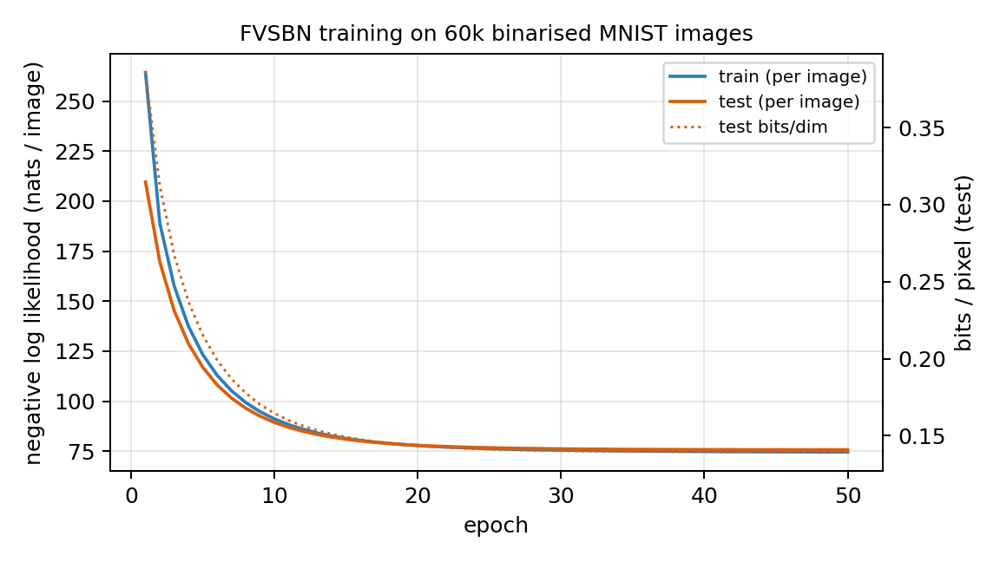
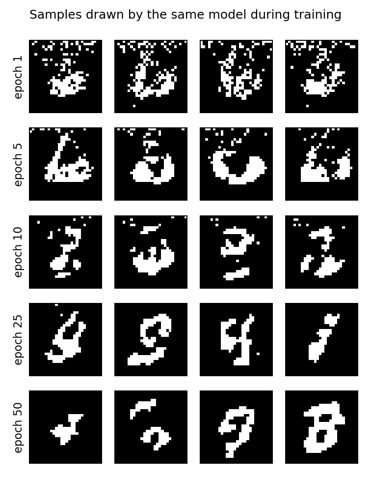
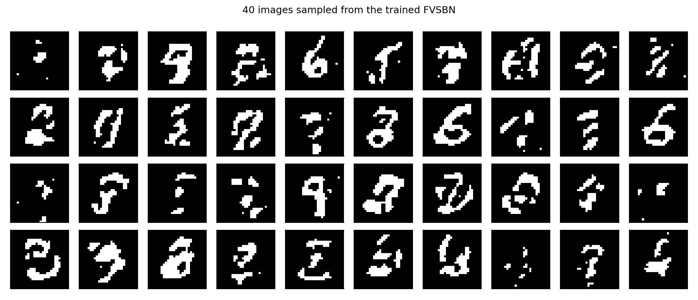
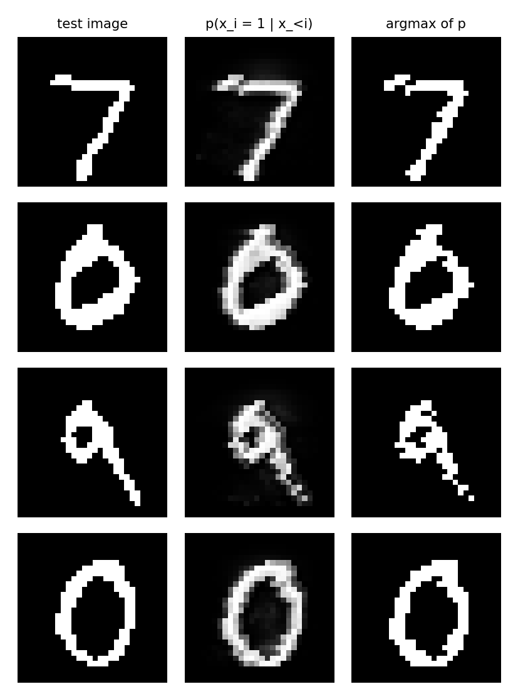
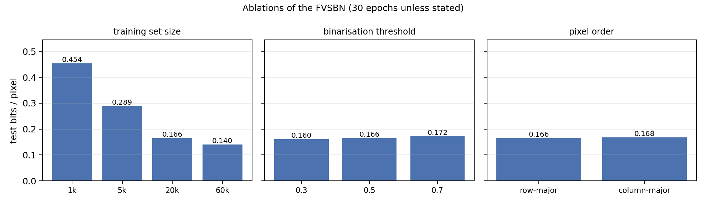

# 3  Task 1: Fully Visible Sigmoid Belief Network (FVSBN)

## 3.1  Model

The assignment asks for image generation with logistic regression, which is the
fully visible sigmoid belief network. The idea is to write the joint distribution
of an image as a product of one conditional per pixel,

    p(x) = prod_i p(x_i | x_<i),

where x_<i are the pixels that come before i in a fixed generation order. For a
binarised 28x28 image the vector has 784 entries and the natural order is
row-major, p = row * 28 + col. Every conditional is a logistic regression on all
previous pixels:

    p(x_i = 1 | x_<i) = sigma(w_i^T x_<i + b_i).

Stacking the 784 rows w_i into a matrix W of size 784x784 gives the vector form
used in `fvsbn.py`:

    logits(x) = x @ (W * mask)^T + b,   mask = tril(ones, -1)

so row i of W only sees pixels with index below i. The model has 615,440
parameters and no hidden layer. It is called *fully visible* because the only
latent quantity is the pixel being predicted: there is no latent variable that
sums over the whole image, so nothing has to be approximated. Training is
ordinary supervised learning on the observed pixels with the negative log
likelihood

    NLL = - sum_i [ x_i log p_i + (1 - x_i) log(1 - p_i) ],

which is exactly 784 binary cross entropies added together, averaged over the
batch. Because every conditional only depends on earlier pixels, the likelihood
can be evaluated in one masked matrix product, and samples can be drawn
ancestrally: draw x_1, then x_2 from p(x_2 | x_1), and so on for 28 sequential
steps.

## 3.2  Experimental setup

MNIST was binarised deterministically with a threshold of 0.5, so a pixel is 1
when it is brighter than 0.5. The fixed threshold keeps the training set
identical between runs, which matters for reproducing the numbers. The resulting
images contain 13.2% ink on average in the training split and 13.4% in the test
split. The 60,000 training images are used for training; the 10,000 test images
are used only for the reported numbers. The test NLL is also the validation
signal during training, which is fine here because there is nothing to tune on
it (the learning rate and batch size were fixed once, see below).

The optimiser is Adam with learning rate 1e-3, batch size 128 and 50 epochs,
seed 0. There is no weight decay, dropout or learning rate schedule. A RTX 3070
Laptop GPU was used, and the same code runs on CPU. Two metrics are reported:
the negative log likelihood per image (sum over the 784 pixels) and bits per
dimension, bpd = NLL / (784 * ln 2). Lower is better and both are defined on the
same binarised data, so they can be compared across the runs in this section.

Three ablations check that the numbers are not an accident of one setting: the
number of training images (1k, 5k, 20k, 60k, 30 epochs), the binarisation
threshold (0.3, 0.5, 0.7, 20k images, 30 epochs) and the pixel order
(row-major versus column-major, 20k images, 30 epochs).

## 3.3  Results

The main run converges quickly and then flattens out (Figure 3.1). The first
epoch already reaches 0.386 bpd, which is close to the unconditional baseline,
and by epoch 10 the model is at 0.164. The final test numbers are 75.75 nats per
image, 0.1394 bpd and 96.0% pixel accuracy under teacher forcing. Training took
30 to 50 s depending on GPU load (about 1 s per epoch, 60,000 images), and
drawing 100 images takes about 0.06 s in the median of five runs, up to 0.15 s
when the GPU is busy, so it is well under a millisecond per image despite the 28
sequential steps.

The reference point is a model that ignores the prefix and predicts every pixel
from its training marginal. That baseline costs 205.85 nats per image (0.3788
bpd), so the FVSBN removes about 63% of the baseline NLL. The gap between train
and test NLL is small (74.6 versus 75.7 at the end), which says the linear model
is underfitting rather than overfitting: more capacity, not more regularisation,
is what this model needs.

Figure 3.2 shows four samples from the same model at epochs 1, 5, 10, 25 and 50.
The first row is noise, by epoch 5 there are blobs, and from epoch 10 on the
strokes of digits appear. Figure 3.3 shows 40 samples of the final model. The
digits are recognisable but thick and sometimes smeared: the model reproduces
the amount of ink (mean pixel 0.131 in the samples against 0.134 in the data)
but not the fine structure, for example the thin diagonal of a 7 or the sharp
corner of a 2.

Figure 3.4 looks at the same test digits in two ways. The middle column is the
teacher-forced probability p(x_i = 1 | x_<i), which is mostly close to 0 or 1:
given the true prefix the model is confident about the next pixel. The right
column is the argmax of that probability, and it reconstructs the digit almost
perfectly. So the per-pixel conditionals are good even though the joint samples
are only rough. This is the usual exposure bias of autoregressive models: when
sampling, the model conditions on its own earlier mistakes instead of the true
pixels, and the small errors accumulate along the 784 steps.

The ablations are collected in Table 3.1 and Figure 3.5. The training set size
is the dominant factor: 1,000 images give 0.454 bpd, 5,000 give 0.289, 20,000
give 0.166 and 60,000 give 0.140. Most of the improvement happens before 20,000
images, and doubling to 60,000 only buys 0.015 bpd. The column-major order is
slightly worse than row-major (0.1677 against 0.1656), which fits the fact that
neighbouring pixels in a row are more correlated than pixels in a column for
this kind of writing. The threshold rows need care: lowering the threshold to
0.3 adds ink and lowers bpd to 0.1604, raising it to 0.7 removes ink and gives
0.1717, but the data distribution is different in each case, so these three
numbers only compare the model with itself at a fixed amount of ink.

| run | images | threshold | order | test NLL | test bpd |
| --- | --- | --- | --- | --- | --- |
| main | 60000 | 0.5 | row | 75.75 | 0.1394 |
| size 1k | 1000 | 0.5 | row | 246.53 | 0.4537 |
| size 5k | 5000 | 0.5 | row | 156.94 | 0.2888 |
| size 20k | 20000 | 0.5 | row | 90.00 | 0.1656 |
| size 60k | 60000 | 0.5 | row | 76.19 | 0.1402 |
| threshold 0.3 | 20000 | 0.3 | row | 87.19 | 0.1604 |
| threshold 0.7 | 20000 | 0.7 | row | 93.32 | 0.1717 |
| column-major | 20000 | 0.5 | col | 91.14 | 0.1677 |

Table 3.1: all runs, 30 epochs except the main run (50 epochs). Bits per
dimension is NLL / (784 ln 2).

## 3.4  Discussion

The model does exactly what a logistic-regression generator can do. Every
conditional is a linear function of the prefix, so the model can learn that a
dark pixel is likely after a run of dark pixels, or that a curve continues in
some direction, but it has no notion of a stroke being the same object at a
different position. There is no weight sharing and no hidden unit that could
detect a local pattern; each of the 784 rows of W has to learn on its own.
That is also why it needs 615,440 parameters, about 4.5 times the number of
values in a single image, and why increasing the training set still helps at
60,000 images.

The sampling experiments are the most interesting part of the section for the
comparison with task 1.2. FVSBN reaches a decent bpd in about a minute of
training, and the teacher-forced reconstructions are nearly perfect, but the
joint samples are blurry. A hidden layer changes exactly this: it can represent
non-linear interactions between pixels and reuse them at every position, which
is the motivation for the neural autoregressive model in the next section. The course also covers estimators for models with
latent units, but FVSBN does not need one: every variable is observed, so the
likelihood is exact and the gradient is the gradient of a binary cross entropy.

Two smaller observations. First, the order of the pixels matters only a little
in terms of NLL (0.1656 versus 0.1677), but it changes what a sample looks like:
with column-major order the strokes are built from top to bottom, so errors in
the first column are copied down the whole image. Second, the per-pixel
conditionals are so confident that a naive argmax of the teacher-forced
probabilities is a good reconstruction, which is why the model is sometimes
described as a *deterministic* pixel predictor. The gap between that
reconstruction and the samples is the price of sampling from the joint.

## 3.5  Limitations

The linear conditionals are the main limitation: for a given prefix the model
predicts one Bernoulli probability per pixel, and a linear logit cannot describe
curved or multi-modal conditional distributions. A second limitation is speed:
sampling needs 28 sequential matrix products, so it is slow compared with a GAN
generator that produces an image in one forward pass. A third is that the model
is unconditional; generating a specific digit would need the label in the
prefix. Adding a hidden layer (task 1.2) and conditioning on the class are the
two obvious extensions, and the ablation table already shows where the gains
would come from: more expressive conditionals, not more data.
