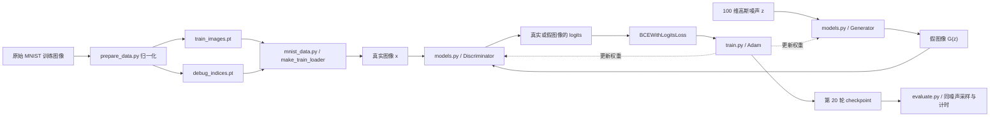

# 代码结构与 GAN 实验原理

本文是项目的代码说明文档，随代码持续更新。调试统一使用 [debug.ipynb](debug.ipynb)，实现代码放在 Python 模块中；[实验方案.md](实验方案.md) 负责说明实验问题和对比设置，[README.md](README.md) 提供运行入口。

当前已实现数据准备、数据加载、G/D 结构、Adam 交替更新、固定采样、训练日志、checkpoint 保存、重载、统一评价采样、推理计时和人工标注汇总。E0–E3 已于 2026-11-06 在 `cs5489` / RTX 4060 Laptop GPU 上完成；600 张人工标注已汇总。新增的 `GAN_report.ipynb` 以全英文正文、表格和图像整理模块说明、生成结果、训练过程和运行时间，并调用辅助模块完成简短演示。

## 1. 文件分工与整体联系

| 文件或目录 | 功能 | 与其他部分的联系 |
|---|---|---|
| `实验方案.md` | 定义 GAN 方法、数据预处理、E0–E3 配置和评价口径 | 为数据、模型及后续训练提供统一依据 |
| `prepare_data.py` | 获取原始 MNIST，处理并保存训练张量、调试索引、统计与预览 | 调用 `mnist_data.py` 的路径常量和 loader；产物供 loader 和 notebook 读取 |
| `mnist_data.py` | 加载处理结果，按正式集或调试子集构造图像批次 | 向 notebook 和后续训练提供相同的数据接口 |
| `models.py` | 定义 `Generator` 与 `Discriminator` | 由 notebook 实例化；后续训练直接复用这两个类 |
| `train.py` | 统一实验配置，执行 G/D Adam 交替更新，保存采样、日志与权重 | 调用数据和模型模块；同时供命令行与 notebook 使用 |
| `evaluate.py` | 加载统一轮次的权重，生成同噪声评价样本、测量推理时间、绘制对比并准备人工标注 | 读取 `train.py` 的产物，通过 `models.py` 重建 G；不训练额外分类器 |
| `report_utils.py` | 读取已完成实验并渲染英文表格、现有图像、checkpoint 演示和人工失败样例 | 为报告提供简短调用，复用 `evaluate.load_generator` 和原实验产物 |
| `debug.ipynb` | 数据、模型、梯度、E0–E3 与统一评价的唯一调试入口 | 调用训练和评价模块，已有完整结果时直接读取 |
| `GAN_report.ipynb` | 全英文报告展示入口，包含说明、图表和少量调用代码 | 通过 `report_utils.py` 使用已有结果；独立于调试工作流 |
| `data/MNIST/raw/` | torchvision 格式的原始数据及压缩包 | 数据准备脚本读取原始训练集；测试集文件仅缓存 |
| `data/processed/` | 归一化训练张量和固定调试子集索引 | 由准备脚本写入，由数据模块读取 |
| `outputs/data/` | 数据统计 JSON、类别计数 CSV、样本和分布图 | 供数据说明与后续作业报告使用 |
| `outputs/E0/seed_42/` | E0 配置、每轮指标、初始与阶段采样、权重及运行汇总 | 供 notebook 检查训练更新并展示早期变化；不计入正式比较 |
| `outputs/E1/seed_42/` 至 `outputs/E3/seed_42/` | 各正式配置的训练产物和 `evaluation/` 自动评价产物 | 分别保存完整 20 轮训练，以及同一组 200 张样本和推理时间 |
| `outputs/comparison/seed_42/` | 统一对比图、CSV/JSON 汇总、匿名标注图及人工标注表 | 连接训练记录、最终图像、计时和后续人工质量评价 |
| `README.md` | 环境、运行方式和维护约定 | 引导使用唯一 notebook 和本文 |
| `.gitignore` | 忽略本地数据和 Python 字节码缓存 | 不改变实验行为 |
| `requirements.txt` | 列出模型、绘图和 notebook 所需依赖 | 在任意兼容的 Python 3.10+ 环境安装；不绑定环境名称或本机路径 |
| `.vscode/settings.json` | 为编辑器设置首选环境管理器和包管理器 | 不指定解释器绝对路径；notebook 可手动选择安装依赖的内核 |

真实数据与生成数据最终在 D 处汇合：

`debug.ipynb` 串联并观察这条链路，`train.py` 根据相应损失的梯度分别调用 G/D 的 Adam 优化器更新权重。

## 2. prepare_data.py：把原始数据变成 GAN 输入

### 2.1 导入、绘图后端与路径

- `argparse` 提供命令行参数，`Path` 管理项目目录，`shutil` 复用已有原始压缩包。
- `csv`、`json`、`platform` 和 `sys` 保存类别统计、处理设置及实际运行环境。
- `MNIST` 读取 torchvision 的原始数据；`torch` 完成张量变换。
- `matplotlib.use("Agg")` 让命令行脚本直接保存 PNG。Notebook 需要交互显示，因此通过子进程运行准备脚本，避免在内核中导入该脚本时改变绘图后端。
- `PROJECT_DIR`、`DEFAULT_DATA_DIR` 从 `mnist_data.py` 导入，使准备与读取使用同一套默认路径。

### 2.2 check_loader(data_dir, debug=...)

调用正式数据接口 `make_train_loader`，遍历一个数据轮次，检查图像的 `float32` 类型、`1×28×28` 形状以及样本总数和最后一批大小，并返回统计字典。

默认 batch size 为 128：完整集 `60000 = 468×128 + 96`，共 469 批；调试集 `6000 = 46×128 + 112`，共 47 批。这对应实验方案的“每轮遍历全部所选样本、保留最后一批”。这里只遍历数据，不训练模型。

### 2.3 save_plots(images, full_counts, debug_counts, output_dir)

| 代码部分 | 功能 | 与实验的关系 |
|---|---|---|
| `images[:64].add(1).div(2)` | 将前 64 张图从 `[-1,1]` 还原到 `[0,1]` | 训练值和显示值分开；显示不改变训练张量 |
| `make_grid(..., nrow=8)` | 按原始顺序组成 8×8 网格 | 直接展示固定位置的样本，便于判断数据是否正确 |
| 两组 `bincount` 的柱状图 | 分别显示完整集和调试子集的 0–9 数量 | 说明训练数据组成，标签只用于统计 |
| `savefig`、`close` | 保存 PNG 并释放图对象 | 为报告提供可复用的数据图表 |

### 2.4 prepare(data_dir, output_dir, raw_cache=None)

这是数据准备的主流程，按以下顺序执行：

1. **建立输出目录。** 处理张量放在 `data/processed/`，统计和图像放在 `outputs/data/`。
2. **获取原始数据。** 指定 `raw_cache` 时复制已有的原始 `.gz` 文件；否则由 torchvision 复用本地文件或下载。`MNIST(train=True)` 只加载 60,000 张原始训练图。torchvision 会同时缓存测试集文件。
3. **转换图像张量。** 原始 `uint8` 张量形状为 `[60000,28,28]`；`unsqueeze(1)` 添加灰度通道；随后转为 `float32`，依次执行 `/255`、`×2`、`−1`，得到 `[60000,1,28,28]`、范围 `[-1,1]`。
4. **固定调试子集。** 独立 `torch.Generator` 以种子 42 生成 `randperm`，取前 6,000 个索引，无放回抽样。它是随机子集，没有按数字类别强制均衡；正式训练仍使用全部 60,000 张。
5. **保存数据。** `train_images.pt` 保存完整图像张量；`debug_indices.pt` 保存子集索引。图像文件没有附带数字类别标签。
6. **统计与检查。** 使用原始标签计算完整集与调试集的类别计数，写入 CSV；核对图像范围和归一化还原关系，再调用 `check_loader` 和 `save_plots`。
7. **记录实际配置。** `data_summary.json` 保存数量、形状、预处理、类别计数、loader 检查结果和 Python/PyTorch 等版本；返回同一份字典。

归一化与生成器最后的 Tanh 对应：真实图像和生成图像进入 D 时具有相同的形状和数值范围。保留灰度信息符合本次原始 MNIST 的要求，代码没有阈值二值化或数据增强。

### 2.5 命令行入口

`if __name__ == "__main__"` 解析参数并调用 `prepare`：

| 参数 | 功能 | 默认值 |
|---|---|---|
| `--data-dir` | 原始数据及处理张量的根目录 | 项目下的 `data/` |
| `--output-dir` | 数据统计和图像目录 | 项目下的 `outputs/data/` |
| `--raw-cache` | 可选的已有原始压缩包目录 | 不指定，交由 torchvision 处理 |

## 3. mnist_data.py：向训练提供图像批次

### 3.1 PROJECT_DIR 与 DEFAULT_DATA_DIR

`PROJECT_DIR` 根据模块文件位置计算项目根目录，`DEFAULT_DATA_DIR` 指向其下的 `data/`。准备脚本、notebook 和后续训练通过这些常量读取同一套数据。

### 3.2 load_train_images(data_dir=...)

从 `processed/train_images.pt` 加载 CPU 张量，返回 `[60000,1,28,28]` 的 `float32` 图像。归一化已在准备阶段完成，这里直接读取，不再次缩放。

返回值本身是 Tensor，具有按索引读取单张图像的能力，因此可以直接作为 DataLoader 的数据集。

### 3.3 make_train_loader(...)

| 代码部分或参数 | 功能 | 与 GAN 实验的关系 |
|---|---|---|
| `load_train_images` | 加载完整训练张量 | 正式实验使用全部 60,000 张 |
| `debug=True` 与 `Subset` | 读取固定索引，选取 6,000 张 | E0 与正式实验的数据规模分开；不修改完整集 |
| `batch_size=128` | 指定每批样本数 | 对应统一实验配置；最后一批按实际数量训练 |
| `shuffle=True` | 每次遍历时重新生成随机顺序 | 减少固定顺序对训练过程的影响 |
| `drop_last=False` | 保留不足 128 张的批次 | 每轮使用全部所选样本 |
| `generator=...manual_seed(seed)` | 用独立随机数流打乱数据 | 可复现初始顺序，也不消耗模型初始化和训练噪声使用的全局随机数流 |
| `num_workers=0` | 默认在当前进程加载 | 适用于目前 Windows 和 notebook 调试方式 |
| `pin_memory=False` | 可选的固定内存设置 | 控制数据传输方式，不改变数据内容或模型结构 |

每个批次只返回 `[B,1,28,28]` 的图像 Tensor。这里的 GAN 是**无条件生成**：G 接收噪声，D 接收图像，均不接收数字标签。

`seed` 控制 loader 的打乱顺序；调试子集成员由已保存的索引决定，不随此参数改变。同一个 loader 跨 epoch 复用时，随机数状态会前进；重新以相同种子创建 loader，可重现最初的批次顺序。

## 4. models.py：G/D 的结构与尺寸变化

本模块只定义网络。调用方设置 `torch.manual_seed(42)` 后实例化模型，使用 PyTorch 默认初始化；各可学习层保留 bias。模型内部不采样噪声，也不执行优化器更新。

### 4.1 Generator.__init__ 与 forward

`latent_dim=100` 指定噪声维度；`use_batchnorm=True` 控制唯一的 BatchNorm。`forward(z)` 依次调用 `project → upsample → output`，其中 `B` 为当前批大小。

| 模块与层 | 输出形状 | 功能与原理 |
|---|---|---|
| 输入 `z` | `[B,100]` | 从标准正态分布采样，提供样本变化来源 |
| `project[0]`: Linear | `[B,6272]` | 将噪声映射为可学习的初始特征 |
| `project[1]`: ReLU | `[B,6272]` | 引入非线性 |
| `project[2]`: Unflatten | `[B,128,7,7]` | 将向量组织成空间特征图，元素总数保持不变 |
| `upsample[0]`: ConvTranspose2d | `[B,64,14,14]` | 学习上采样和特征变换；kernel=4、stride=2、padding=1 |
| `upsample[1]`: BatchNorm2d 或 Identity | `[B,64,14,14]` | 基线进行通道归一化；E3 用 Identity 跳过此步 |
| `upsample[2]`: ReLU | `[B,64,14,14]` | 对上采样特征引入非线性 |
| `output[0]`: ConvTranspose2d | `[B,1,28,28]` | 再上采样到 MNIST 灰度图尺寸，卷积配置与上一层相同 |
| `output[1]`: Tanh | `[B,1,28,28]` | 将输出限制到 `[-1,1]`，与真实数据预处理范围对应 |

上述转置卷积在当前配置下满足 `H_out = (H_in−1)×2 − 2 + 4 = 2H_in`，因此空间尺寸由 7 变成 14，再变成 28。

基线 G 有 **765,761** 个可学习参数；关闭 BatchNorm 后为 **765,633**，少的是 64 个通道各自的缩放和偏置，共 128 个参数。BatchNorm 的运行均值和方差属于缓冲状态，不计入可学习参数量。

消融时保持相同种子和 G/D 构造顺序，共同层初始参数可对齐。BatchNorm 是否改善训练质量和稳定性，需要后续正式实验判断。

### 4.2 Discriminator.__init__ 与 forward

`forward(images)` 依次调用 `features → classifier`，将真实或生成图像映射为一个 logit。

| 模块与层 | 输出形状 | 功能与原理 |
|---|---|---|
| 输入图像 | `[B,1,28,28]` | 来自真实数据 loader 或 G 的输出 |
| `features[0]`: Conv2d | `[B,64,14,14]` | 提取局部笔画等特征，同时降低空间分辨率 |
| `features[1]`: LeakyReLU(0.2) | `[B,64,14,14]` | 负半轴保留 0.2 的斜率，为负输入保留梯度 |
| `features[2]`: Conv2d | `[B,128,7,7]` | 提取进一步的特征，并再次下采样 |
| `features[3]`: LeakyReLU(0.2) | `[B,128,7,7]` | 引入非线性 |
| `classifier[0]`: Flatten | `[B,6272]` | 保留批次维，将空间和通道维展开 |
| `classifier[1]`: Linear | `[B,1]` | 为每张图输出一个真假 logit |

两层卷积均使用 kernel=4、stride=2、padding=1，当前尺寸满足 `H_out = (H_in+2−4)/2+1 = H_in/2`，即 28 → 14 → 7。D 共 **138,561** 个可学习参数，不包含 BatchNorm 或 Dropout。

D 的 logit 是一个实数；`sigmoid(logit)` 可解释为判真概率。计算损失时直接输入 logit，因为 `BCEWithLogitsLoss` 已将 Sigmoid 与二元交叉熵合在一起。这里的目标 1/0 表示“真实/生成”，与 MNIST 的数字类别 0–9 无关。

## 5. debug.ipynb：唯一调试入口及各代码段

Notebook 先完成数据检查，再在同一内核中接入模型；公共导入与环境设置只保留一处。下面按代码单元 ID 对照，便于后续增补时保持文档同步。

| 代码单元 ID | 主要功能与上下文 | 对应的实验环节 |
|---|---|---|
| `environment` | Windows 当前环境存在 `Library/bin` 时补充 DLL 路径；导入数据与模型模块；开启内嵌绘图并自动选择 CUDA/CPU | 不检查环境名称，使用当前 notebook 选择的 Python |
| `data-load-data` | 处理文件缺失时用 `sys.executable` 子进程调用准备脚本；加载 `images`、原始训练集 `raw` 和 `debug_indices` | 建立真实数据输入；已有处理文件时直接读取 |
| `data-normalization-check` | 核对形状、类型、范围及前 64 张的变换公式；展示一张图的原值、GAN 输入值和显示值 | 核对真实图像范围与 G 的 Tanh 输出相容，并保留灰度信息 |
| `data-sample-grid` | 展示原始顺序前 64 张训练图 | 直观检查图像方向、尺寸和灰度 |
| `data-subset-distribution` | 重现种子 42 的调试索引，检查无重复，统计并绘制两组类别计数 | 区分调试和正式数据；标签只用于分布说明 |
| `data-loader-check` | 创建 `formal_loader`、`debug_loader`；`inspect_loader` 遍历并返回各自第一批图像 | 检查批次接口和每轮样本数量，覆盖不足一批的末批 |
| `data-shuffle-check` | 重新创建 loader 比较第一批；继续遍历原 loader；比较全局随机状态 | 核对数据顺序可复现、跨轮变化、与模型随机流分开 |
| `model-create-models` | 种子 42 下创建基线 G/D 和 `criterion`，打印结构与参数量 | 建立实验方案的基线结构与损失接口 |
| `model-shape-check` | `show_shapes` 逐层显示尺寸；以独立种子 2026 创建 `fixed_noise`；检查批大小 1/128/96/112 | 验证噪声 → 图像 → logit 的尺寸连接，兼容末批 |
| `model-ablation-check` | 同种子重建无 BN 的 G/D，核对共同参数、结构和参数量差异 | 确认 E3 只改变 G 的 BatchNorm |
| `model-initial-preview` | G 在评估模式与关闭梯度记录下生成固定噪声网格，显示时映射到 `[0,1]` | 建立固定展示输入；当前图像只代表初始化输出 |
| `model-gradient-check` | 新建检查用 G/D，取一批真实图像，分别检查 D 和 G 损失的反向传播 | 验证对抗学习计算图、detach 与冻结 D 的用法 |
| `train-e0-config` | 导入训练模块、读取 E0 配置，指定 `E0_OUTPUT_DIR` | 显示正式执行的调试规模、超参数和结果位置 |
| `train-e0-run` | 已有完整汇总时读取，否则调用 `run_experiment('E0')` 从新模型开始训练 | 真正执行 2 epochs、G/D 各 94 次更新，与前面的只计算梯度检查分开 |
| `train-e0-results` | 读取 CSV/checkpoint；核对样本数、有限指标、Adam 步数及相对初始模型的参数变化；重载 G 并绘制阶段图和曲线 | 检查优化器确实更新模型、权重可用于采样，并观察早期输出 |
| `formal-config` | 读取 E1–E3 单因素配置，指定正式输出与对比目录 | 核对全量数据、统一预算、学习率和 BatchNorm 变化 |
| `formal-run` | 按序运行或读取 E1–E3，核对各 20 轮、60,000 张、469 批、末批 96 张和 9,380 次更新 | 使用同一训练实现进行公平比较，保留原始日志 |
| `formal-evaluate` | 首次调用统一评价；已有结果时只刷新人工标注，保留推理计时，打印质量指标与进度 | 固定第 20 轮与同一评价噪声；避免缓存导致新标注未生效 |
| `formal-results` | 核对噪声与计时设置一致，展示最终样本、基线进展、训练曲线与 11 类计数图 | 用图像、人工分布和训练过程共同支持质量与稳定性讨论 |

`show_shapes` 按当前两个模型的 Sequential 模块顺序执行各层，用于观察尺寸；实际模型调用仍以 `forward` 为准。它不是面向任意网络结构的通用追踪器。

当前 notebook 保存可执行单元的实际输出和图表。正式训练时重新创建模型和 loader，避免调试遍历推进随机状态或训练模式下的 BatchNorm 前向改变运行统计。

## 6. 损失与计算图：代码为什么这样连接

设 `a_r = D(x)`、`a_f = D(G(z))` 为 D 输出的 **logits**，`BCELogits` 表示 `BCEWithLogitsLoss`，则本实验最小化：

\[
L_D = \operatorname{BCELogits}(a_r,1) + \operatorname{BCELogits}(a_f,0)
\]

\[
L_G = \operatorname{BCELogits}(D(G(z')),1)
\]

每个 BCE 项默认按批次取均值，D loss 是真实项均值与假图项均值之和。G 使用使假图被判为真的非饱和目标，`z'` 是重新采样的噪声。

### 6.1 D 阶段：让 D 区分真实与生成

1. G 生成 `fake_images`。
2. `d(real_images)` 的目标为全 1，`d(fake_images.detach())` 的目标为全 0；目标使用 `ones_like`、`zeros_like` 与 logit 保持相同的 `[B,1]` 形状。
3. `d_loss.backward()` 计算 D 参数梯度。
4. `detach()` 切断这条损失到 G 的反向路径，因此此阶段 G 没有参数梯度。

`train_one_epoch` 在此阶段执行 `optimizer_d.step()`；notebook 第 10 节的独立梯度检查只执行反向传播。

### 6.2 G 阶段：让生成图被 D 判为真实

1. 清空 D 的上一阶段梯度，调用 `d.requires_grad_(False)` 冻结 D 参数。
2. 重新采样噪声，由 G 生成新图；经过 D 后以全 1 为目标计算 G loss。
3. `g_loss.backward()` 的梯度经过 D 对输入的运算传回 G，D 参数不累计梯度。
4. 恢复 D 参数的 `requires_grad`，供下一批训练使用。

G 阶段需要保留经过 D 的计算图，因此这里不能用 `torch.no_grad()` 包住 D 的前向，也不能对新生成图使用 `detach()`。`train_one_epoch` 在此阶段执行 `optimizer_g.step()`。

### 6.3 三种控制方式的区别

| 操作 | 当前用途 | 对计算的影响 |
|---|---|---|
| `model.eval()` | 尺寸检查、固定噪声预览 | 切换模块行为；本项目中让 G 的 BatchNorm 使用运行统计，不更新该统计；仍可计算梯度 |
| `torch.no_grad()` | 无需反向传播的尺寸检查与展示 | 不记录这段运算的梯度图；不会自动把模型切换到评估模式 |
| `d.requires_grad_(False)` | G 的反向传播阶段 | 不计算 D 参数的梯度，同时仍可通过 D 向 G 的输出传递梯度 |

`backward()` 只计算梯度，权重更新由优化器的 `step()` 完成。Notebook 第 10 节使用临时 G/D 只检查梯度，第 12 节调用训练实现执行实际更新。训练模式下 G 的前向仍会更新 BatchNorm 缓冲统计，这与优化器更新权重是两件事。

## 7. train.py：真实训练、记录与保存

### 7.1 导入与 Windows DLL 路径

脚本在导入 PyTorch 前，仅在 Windows 且当前 Python 环境确实存在 `Library/bin` 时，将该目录放到当前进程 PATH 前面，供 Conda 环境加载 cuDNN；普通 venv 和其他系统跳过此设置。`run_experiment` 不检查环境名称，`auto` 设备优先 CUDA，否则 CPU，也可显式指定。

`dataclass` 管理统一配置，`csv/json` 记录指标和运行信息，`perf_counter` 测量耗时；`save_image` 保存样本网格。绘图直接创建 `Figure`，因此导入训练模块不会切换 notebook 的内嵌绘图后端。

### 7.2 TrainConfig 与 get_experiment_config

`TrainConfig` 保存实验名、种子、数据选择、epochs、批大小、噪声维度、学习率、Adam betas/weight decay、BatchNorm 开关以及展示噪声设置。`get_experiment_config(experiment, seed)` 根据原方案构造配置：

| 实验 | 数据量 | Epochs | G/D 共同学习率 | G 的 BatchNorm |
|---|---:|---:|---:|---|
| E0 | 固定 6,000 | 2 | 0.0002 | 有 |
| E1 | 60,000 | 20 | 0.0002 | 有 |
| E2 | 60,000 | 20 | 0.0001 | 有 |
| E3 | 60,000 | 20 | 0.0002 | 无 |

共同设置为 batch size 128、latent dim 100、Adam betas=(0.5,0.999)、weight decay 0、初始化种子 42，以及独立种子 2026 的 64 个展示噪声。E1–E3 分别重新创建模型、优化器和 loader，不从 E0 权重继续训练。

### 7.3 synchronize、make_fixed_noise 与 save_samples

| 函数 | 功能 | 对实验的意义 |
|---|---|---|
| `synchronize(device)` | CUDA 设备上等待已提交的 GPU 运算完成；CPU 上直接返回 | 使耗时覆盖实际 GPU 计算 |
| `make_fixed_noise(config)` | 用独立的 CPU `torch.Generator` 创建 `[64,100]` 标准正态噪声 | 各轮使用相同输入；采样不消耗训练噪声的随机数流 |
| `save_samples(generator, noise, path)` | 暂时切换 G 到 eval，关闭梯度记录，生成后映射到 `[0,1]` 保存 8×8 PNG，最后恢复原模式 | 固定输入观察学习变化；展示不修改 BatchNorm 统计或后续训练模式 |

epoch 0 图在训练计时前保存，用于对照初始化输出。每个训练 epoch 完成后的采样和 checkpoint 保存均计入该轮耗时。

### 7.4 train_one_epoch

该函数接收 G/D、loader、两个优化器、损失函数和设备，遍历所选数据一轮，按第 6 节计算图逐批执行：

1. 设置 G/D 为训练模式，将当前真实图像移到设备，并以实际 `len(real_images)` 作为本批大小。
2. 清空上一批梯度，采样噪声并生成图像；以 `detach()` 后的假图计算 D loss，反向传播并执行一次 `optimizer_d.step()`。
3. 清空 D 梯度、冻结 D 参数；重新采样噪声计算 G loss，反向传播并执行一次 `optimizer_g.step()`，随后恢复 D 参数可训练状态。
4. 将 G loss、D loss、D 对真实和生成图像的平均判真概率乘以当前批大小，再累计；最后除以本轮样本总数。这避免把末批 112 张与其他 128 张批次赋予同样的整批权重。
5. 返回加权均值，以及样本数、批次数、末批大小和 G/D 更新次数。

概率取自 **D 更新阶段、D optimizer step 之前** 的真实和假图输出；G loss 则来自本批 D 已更新后的新假图。概率和损失观察的是不同阶段，应按该口径解读。

E0 每轮 47 批，2 轮后 G、D 各有 94 次更新；E1–E3 每轮 469 批，20 轮后各有 9,380 次更新，末批大小为 96。训练没有新增标签平滑、额外噪声注入、正则项或混合精度设置。

### 7.5 save_training_curves

接收每轮历史字典，用两个子图保存 G/D 原始均值损失曲线与 D 阶段真假概率曲线。不平滑、不挑选轮次；曲线绘制在训练循环结束后进行，不计入训练时间。GAN loss 不能单独代表生成质量。

### 7.6 run_experiment

这是 notebook 和命令行共用的训练入口：

1. 读取配置并选择设备，设置种子，按 G → D 的顺序重新初始化网络，创建各自的 Adam 和 `BCEWithLogitsLoss`。
2. 创建全新的 loader，避免继承 notebook 调试遍历后的随机顺序；每个 epoch 复用该 loader。
3. 创建新的结果目录、保存实际配置和环境版本、固定噪声及 epoch 0 预览。目录需是新目录，防止不同次运行的记录混合。
4. 启动计时，循环调用 `train_one_epoch`，保存每轮图像与 checkpoint，记录 epoch/cumulative 耗时并写入 CSV；GPU 计时边界调用 `synchronize`。
5. 训练循环结束后保存曲线与 `summary.json`，返回汇总字典。

Checkpoint 包含 G/D 的 `state_dict`（含 G 的 BN 缓冲）、两个 Adam 状态、配置、epoch、当轮指标、CPU/CUDA 随机状态和 loader 随机状态。当前记录了恢复所需的主要状态，但尚未提供断点续训命令。

总 `training_seconds` 覆盖训练循环、每轮采样、权重/指标写盘与进度输出，排除数据/模型准备、epoch 0 预览、训练后曲线和汇总写入。每轮耗时在采样和 checkpoint 保存后读取，再将该时刻的数值写入 CSV；因此最后一行累计时间与总时间之间会有末次日志写入等少量开销。

### 7.7 命令行入口

`--experiment` 选择 E0–E3，默认 E0；`--seed` 默认 42；`--data-dir` 指向处理数据；`--output-dir` 指定新结果目录，默认 `outputs/<实验名>/seed_<种子>/`；`--device` 可选 auto/cpu/cuda，auto 优先使用 GPU。参数解析后统一调用 `run_experiment`，没有另一份独立训练逻辑。

### 7.8 当前 E0 实际运行记录

2026-11-06，种子 42，两轮各完整遍历固定 6,000 张图像，每轮 47 批、末批 112 张。G/D 各执行 94 次 Adam 更新；notebook 核对了两个优化器的实际 step、参数变化，以及 checkpoint 重新加载后的 64 张图像输出。

| Epoch | G loss | D loss | D(real) | D(fake) | 每轮耗时 / s |
|---|---:|---:|---:|---:|---:|
| 1 | 2.3951 | 0.4609 | 0.8476 | 0.2217 | 0.3756 |
| 2 | 5.0361 | 0.0786 | 0.9816 | 0.0319 | 0.2687 |

训练循环总耗时为 **0.6459 s**，包含每轮采样与保存，不含整个 notebook 的环境加载和结构检查。该次训练开始前，notebook 已执行 GPU 前向/反向检查，epoch 0 采样也已完成；该数值对应框架和设备已就绪后的短程运行，不用于直接推算正式全量训练耗时。原始数值见 [metrics.csv](outputs/E0/seed_42/metrics.csv) 和 [summary.json](outputs/E0/seed_42/summary.json)。

阶段图主要仍为噪声斑块和模糊笔画，尚未形成清晰数字。两轮中 D loss 降低、G loss 升高，D(real) 接近 1、D(fake) 接近 0，表明本次早期阶段 D 较容易区分真假。只有两轮调试数据，不能据此判定正式训练失败或模式崩溃；E0 的流程验证已完成，后续完整训练的观察见第 7.9 节。

### 7.9 当前 E1–E3 实际运行记录

2026-11-06，三组按 E1 → E2 → E3 顺序分别重新初始化，均完成 20 轮 × 60,000 张，每轮 469 批、末批 96 张。每组累计样本访问 1,200,000 次，G/D 各更新 9,380 次；第 20 轮两个 Adam 状态中的实际 step 已核对。每轮指标、21 张阶段网格（含 epoch 0）和 20 份 checkpoint 均已保存。

| 实验 | 最终 G loss | 最终 D loss | 最终 D(real) | 最终 D(fake) | 训练循环 / s | 推理 1,000 张 / ms，均值 ± 标准差 |
|---|---:|---:|---:|---:|---:|---:|
| E1 | 1.1252 | 1.0433 | 0.6271 | 0.3729 | 335.65 | 6.222 ± 0.321 |
| E2 | 0.9863 | 1.1010 | 0.5986 | 0.4014 | 102.36 | 5.319 ± 0.145 |
| E3 | 1.1783 | 1.0244 | 0.6376 | 0.3626 | 48.32 | 4.583 ± 0.239 |

这些损失和概率取自各自的训练阶段，不是数字可辨认率。E1 第一个全量 epoch 实测为 18.14 s，E2 为 18.24 s，E3 为 2.65 s；E2 同一次运行的单轮耗时范围为 2.45–18.24 s，显示实际运行时延明显变化。未定位该变化的具体原因，不能把训练总耗时差异解释为调低学习率或移除 BN 的因果效果。E1/E2 网络结构和计算规模相同，其推理时间差也不能归因于训练学习率。原始每轮耗时和评价均值/标准差均保留。

在固定展示中，E1 从第 1 轮的模糊笔画，到第 5 轮形成较清楚字形，后续同一输入的形状相对稳定。三组第 20 轮的同噪声前 64 张均出现多种可辨认数字，仍有变形、模糊或混合笔画；最终展示中未出现全部输入变成同一字形的明显现象。E3 本次移除 BN 后仍能形成多种数字，但不能据单种子运行断言 BN 无用。全部 200 张的人工结果见第 8.8 节。

## 8. evaluate.py：统一评价与对比

### 8.1 导入与调用关系

先导入 `train.py`，复用其 Conda DLL 路径设置、项目目录与 GPU 同步函数；随后使用 `models.py` 重建 G。绘图继续使用独立 `Figure`，不改变 notebook 后端。`EXPERIMENTS` 固定为 E1/E2/E3；该模块只加载已有权重，不更新训练参数。

### 8.2 load_generator 与 evaluate_run

`load_generator(run_dir, device, epoch=20)` 按 checkpoint 配置创建相同结构的 G，恢复包含 BN 缓冲的 `state_dict` 并切换到 eval，返回 G 与 checkpoint。指定 epoch 的接口也用于绘制基线阶段图。

`evaluate_run` 完成以下步骤：

1. 核对 20 行训练记录，每轮 60,000 张、469 批、末批 96 张；读取第 20 轮 checkpoint，核对 G/D 的 Adam step 均为 9,380。
2. 以独立种子 **2027** 生成 `[200,100]` 的标准正态噪声，在 eval/no_grad 下生成 `[200,1,28,28]` 图像，保存噪声和 `[-1,1]` 图像张量。
3. 将前 64 张还原到 `[0,1]`，固定排成 8×8 PNG。不同实验使用同一输入顺序，不挑选样本。
4. 调用推理计时函数，保存每次测量及自动评价汇总。

训练展示噪声的种子为 2026，最终评价噪声的种子为 2027；两者用途不同，最终对比图使用后者。

同一个噪声向量在不同配置下不保证生成相同数字；统一噪声固定的是抽样输入，不是给模型指定数字类别。因此跨配置同一位置的数字类别变化本身不表示生成错误。

### 8.3 benchmark_inference

使用独立种子 **2028** 预先生成 1,000 个噪声并放到设备上，G 保持 eval/no_grad。先预热 10 次，再测量 30 次，每次在起止处同步 GPU，计时只覆盖 G 的前向生成。模型加载、噪声生成/传输、绘图和保存均排除。

返回 1,000 张的批次均值、样本标准差（30 次测量，分母为 n−1）和原始秒数；`amortized_image_mean_ms = batch_mean_ms / 1000`。该摊销耗时不是单张请求延迟。计时重复的标准差也不代表不同训练种子的结果差异。

### 8.4 save_comparison_figures

| 输出图 | 数据来源与选择规则 | 对应问题 |
|---|---|---|
| `final_samples.png` | E1–E3 第 20 轮，各取评价噪声 2027 对应的前 64 张 | 固定训练预算下的质量和多样性有何差别？ |
| `training_comparison.png` | 各组全部 20 轮的原始 G/D loss 和 D 阶段真假概率 | 是否存在持续失衡、波动或后期变化？ |
| `baseline_progress.png` | E1 第 1/5/10/15/20 轮，训练展示噪声 2026 的前 4 个向量 | 相同输入随训练如何演进？ |

基线进展图重新加载对应阶段的权重采样，不从网格中挑选较好的图片。图像与曲线需结合解读，不能单独按 loss 排名生成质量。

### 8.5 prepare_annotations 与 summarize_annotations

`prepare_annotations` 用独立的 Python 随机流（种子 2029）将实验映射到匿名 A/B/C，映射保存到 `annotation_key.json`。每组 200 张分成两页带样本 ID 的标注图，`annotations.csv` 提供 600 行空白标签和备注。已有标注表保持原样，重跑不会覆盖填写内容。

人工查看匿名图片，按 `set_id` 和 `sample_id` 填写 0–9 或 `unreadable`，也接受“无法辨认”。标注前避免查看映射表，可减少已知实验名称的影响。

`summarize_annotations` 读取 UTF-8 或带 BOM 的 CSV，核对各组 200 个 ID 和标签值。`issues` 分别报告缺失、空白、重复、越界 ID 和无效标签，`labeled_count` 只计有效标签。未填完返回 `pending_annotation`，有无效标签等问题返回 `invalid_annotation`，该组最终指标均保持为空；不会改写人工标签或把缺失行当成无法辨认。

只有每组 200 个有效标签齐全时，才计算可辨认率、类别覆盖、无法辨认数量及包含无法辨认类的 11 类计数。类别覆盖无法排除类别内部的近似重复，仍需结合图片记录观察。

### 8.6 evaluate_experiments 与命令行入口

`evaluate_experiments(outputs_dir, seed, device)` 按 E1 → E2 → E3 统一评价，核对三组噪声完全相同，生成对比与匿名标注图，统计已有人工标签，将训练/推理/质量状态写入 `comparison.csv` 和 `summary.json`。评价等待全部训练结束后执行，避免 GPU 争用干扰计时。

`comparison.csv` 还保存各组单轮耗时的最小值和最大值，供识别实际运行时延变化。其 `status` 字段表示人工标注状态，`pending_annotation` 不表示训练尚未完成；训练完成状态与实际更新验证记录在各训练和评价 JSON 中。

命令行参数为 `--outputs-dir`、`--seed` 和 `--device`（auto/cpu/cuda，默认 auto），不检查环境名称；auto 优先 CUDA，不可用时使用 CPU。完整评价入口会重新采样和测量推理时间；人工标注后应使用 `--annotations-only` 只刷新标注结果。

### 8.7 save_class_distribution、save_comparison_summary 与 refresh_annotations

| 函数 | 代码功能与联系 |
|---|---|
| `save_class_distribution(annotations, path)` | 用统一纵轴绘制 E1–E3 的 0–9 与 U（无法辨认）共 11 类计数；未完成组明确显示状态，不绘制假定计数 |
| `save_comparison_summary(comparison_dir, summary)` | 复用已有训练和推理数值，将新人工指标写入 `comparison.csv`、`class_counts.csv`、`class_distribution.png` 与 `summary.json`；供完整评价和仅刷新入口共用 |
| `refresh_annotations(outputs_dir, seed)` | 从已有统一汇总与匿名映射读取上下文，调用标注统计和保存函数；不训练、不重采样、不重新计时，返回更新后的汇总 |

命令行 `--annotations-only` 调用 `refresh_annotations`；notebook 第 16 节在评价结果已存在时也调用它，解决仅读取旧 JSON 时新标签未进入结果的问题。缺失或无效的人工判断由用户补正，解析器只报告，不猜测。

### 8.8 当前人工评价结果

600 张标注已填写，并按用户确认补齐 A013=5、修正 C161=3。匿名映射为 A→E3、B→E2、C→E1；每组 200 个有效标签，包含所有 ID，未重新生成样本或测量推理时间。

| 实验 | 可辨认张数 /200 | 可辨认率 | 无法辨认数 /200 | 类别覆盖 |
|---|---:|---:|---:|---:|
| E1 | 179 | 89.5% | 21 | 10/10 |
| E2 | 168 | 84.0% | 32 | 10/10 |
| E3 | 164 | 82.0% | 36 | 10/10 |

在本次 20 epochs、种子 42 的运行中，降低共同学习率后可辨认率比 E1 低 5.5 个百分点，移除 G 的 BN 后低 7.5 个百分点。结论仅为本次固定训练预算的描述，不能推断长期训练效果或跨种子的统计显著性。

三组虽然覆盖全部数字，但数字 1 仅分别有 4/4/3 张，数字 9 有 38/37/46 张，说明分布偏斜仍存在。类别覆盖高不能代替均衡性、多样性和类内重复检查；接下来结合失败样例、同类字形和训练阶段图讨论模式崩溃与稳定性。计数图见 [class_distribution.png](outputs/comparison/seed_42/class_distribution.png)，原始计数见 [class_counts.csv](outputs/comparison/seed_42/class_counts.csv)。

## 9. 已有产物与后续代码如何衔接

| 产物 | 内容与用途 |
|---|---|
| `data/processed/train_images.pt` | 完整图像张量，供 E1–E3 使用 |
| `data/processed/debug_indices.pt` | 固定 6,000 个索引，供 E0 使用 |
| `outputs/data/data_summary.json` | 数据准备过程及环境的实际记录 |
| `outputs/data/label_counts.csv` | 数字 0–9 的完整集和调试集计数 |
| `outputs/data/training_samples.png` | 前 64 张真实训练图，显示时还原到 `[0,1]` |
| `outputs/data/label_distribution.png` | 完整集和调试集的类别分布 |
| `outputs/E0/seed_42/config.json` | 实际超参数、数据量、设备和版本 |
| `outputs/E0/seed_42/fixed_noise.pt` | 独立种子 2026 的 64 个 CPU 噪声向量 |
| `outputs/E0/seed_42/metrics.csv` | 每轮损失、判真概率、样本/更新数量及耗时 |
| `outputs/E0/seed_42/samples/epoch_000.png` 至 `epoch_002.png` | 同一组噪声的初始化和两轮输出 |
| `outputs/E0/seed_42/checkpoints/epoch_001.pt`、`epoch_002.pt` | 对应轮次的 G/D、Adam、随机状态与配置 |
| `outputs/E0/seed_42/training_curves.png` | 两轮原始损失与 D 概率曲线 |
| `outputs/E0/seed_42/summary.json` | 是否完成、训练总耗时、总更新次数和最终指标 |
| `outputs/E1/seed_42/` 至 `outputs/E3/seed_42/` | 与 E0 相同结构，各保存 20 轮日志、权重和 21 张阶段图（含 epoch 0） |
| 各正式目录的 `evaluation/noise.pt`、`images.pt`、`first_64.png` | 评价噪声、全部 200 张图像张量和固定前 64 张网格 |
| 各正式目录的 `evaluation/inference_timings.csv`、`summary.json` | 30 次推理计时及自动评价汇总 |
| `outputs/comparison/seed_42/` 的三张对比图、`comparison.csv`、`summary.json` | 最终样本、训练过程、基线进展和统一指标 |
| 同目录的 `class_counts.csv`、`class_distribution.png` | 600 张人工标注的 11 类计数与统一纵轴分布图 |
| 同目录的 `annotations.csv`、`annotation_A_1.png` 等六页、`annotation_key.json` | 匿名人工标注表、600 张带 ID 的图片和映射 |
| `debug.ipynb` 的单元输出 | 数据、模型、E0–E3 训练/重载及自动评价记录；E0 不纳入正式排名 |

本次 E1–E3 已复用 `train.py` 完成相同 epoch 预算的比较，分别重新初始化模型和数据顺序，不继承 E0 权重。第一个全量 epoch 的耗时已随正式运行记录，作为预算估计依据；原始记录显示后续耗时明显变化，因此最终采用实测累计值，不用 E0 的短程时间外推。

统一采样、推理计时和 600 张人工标注统计已完成。英文报告已结合阶段图、曲线、人工分布和无法辨认样例形成结果、稳定性、局限和结论文字。类内重复没有额外量化指标，报告保留相应局限；单个训练种子的对比只描述本次观察，不宣称统计显著性。

## 10. report_utils.py 与 GAN_report.ipynb：英文报告展示

### 10.1 与现有实现的关系

报告以 Markdown 为主体，共有 10 个短代码单元、14 行调用代码；网络定义、训练循环和完整评价实现仍保留在原模块。辅助模块先从 `train.py` 获取项目目录与可选的 Windows DLL 路径设置，再复用 `evaluate.load_generator`。安装 `requirements.txt` 后可选择任意兼容的 Python 3.10+ 内核；演示优先 CUDA，否则 CPU。

`GAN_report.ipynb` 是结果展示报告，`debug.ipynb` 继续是唯一调试 notebook。报告按“目标、数据、模型与损失、设置、训练、生成、人工评价、运行时间、讨论、代码复现”组织，全篇英文。保存后的表格和 PNG 输出已嵌入 notebook；重新执行需有模块和原结果文件。

### 10.2 辅助模块各部分

| 函数或代码部分 | 功能与联系 |
|---|---|
| 导入部分 | 复用已有环境与模型加载函数；使用独立 `Figure` 和 IPython display，不切换 notebook 后端 |
| `load_report_data()` | 读取种子 42 的统一汇总、E0–E3 配置和数据记录，要求人工标注已完成；只读已有结果，返回报告上下文 |
| `_display_table(headers, rows)` | 将表头和记录格式化为 Markdown 表格，供统一表格接口使用 |
| `show_table(report, table)` | 根据 experiments/quality/runtime/losses/environment 选择器渲染实验配置、人工评价、计时、最终损失和环境表；直接读取实际数值 |
| `show_figure(report, relative_path, width)` | 显示已有 PNG 并嵌入单元输出，用于数据、训练、样本和类别分布图 |
| `_save_report_figure(report, figure, filename, width)` | 将新增报告图保存到 `outputs/report/seed_42/`，随后嵌入输出；不修改原实验图 |
| `show_checkpoint_demo(report, experiment='E1', count=8)` | 重载第 20 轮 G，取已保存评价噪声的前 8 个，eval/no_grad 前向生成并展示；不更新权重、不重新计时 |
| `show_failure_examples(report)` | 根据匿名映射和原始人工标签，按样本 ID 取每组前 4 张 unreadable 图，读取既有图像张量后绘图；不重新判断类别，也不挑选最差样本 |

新增的 `checkpoint_demo.png` 与 `failure_examples.png` 均为报告展示产物。后者标题保留实验和样本 ID，便于追溯人工标注。报告计时表仍来自原 30 次同步测量，演示前向不替换该记录。

### 10.3 报告各代码单元

| 代码单元 ID | 报告功能与原理联系 |
|---|---|
| `report-setup` | 导入展示函数并加载既有上下文；初始化部分默认收起 |
| `report-data-examples` | 展示原始训练图，连接灰度数据和预处理说明 |
| `report-settings` | 展示 E0–E3 单因素配置与实际环境 |
| `report-training-curves` | 展示全部训练曲线和最终 loss/概率表，说明对抗优化动态 |
| `report-training-progress` | 展示 E1 的 5×4 阶段图，固定噪声观察学习变化 |
| `report-final-examples` | 展示 E1–E3 同一组评价噪声的前 64 张输出 |
| `report-checkpoint-demo` | 实际调用已训练 G，验证保存的权重可用于生成 |
| `report-quality-results` | 展示全部 200 张的人工质量表与含无法辨认类的分布图 |
| `report-failure-examples` | 展示有人工标签依据的失败样例，支持质量局限讨论 |
| `report-runtime-results` | 展示训练和推理口径、均值/标准差、每轮范围及摊销时间 |

模块说明和模型层表写在报告正文中，不依赖跳转至代码才能理解。报告只读取保存的汇总，不自动刷新标注；如标注改变，先运行 `evaluate.py --annotations-only`，再重新执行报告，并同步更新与数值相关的文字。

### 10.4 跨环境运行

脚本和 notebook 已移除对 `cs5489` 的环境名断言；两个 notebook 均使用通用 `python3` 内核元数据。数据、输出和权重通过模块所在目录及相对路径读取，Windows 的 Conda DLL 兼容设置仅在目录存在时生效。归档配置中的 `python_executable`、旧 `data_dir` 和原实验环境描述保留用于复现追溯，不会被用于启动解释器或覆盖当前路径。报告环境表明确展示原始训练和计时配置，不把它当作当前内核要求。

在其他机器运行时需要安装依赖并保留相应产物：报告重执行需要源码、`outputs/` 图表和权重；调试数据检查还需处理数据或重新获取 MNIST。软件包的已安装版本、CUDA 支持与实际执行硬件会影响重跑时间和数值，原记录仍代表原实验。

跨环境验证已使用另一套 PyTorch 2.9.1 / torchvision 0.24.1 / matplotlib 3.10.8 环境完成，并禁用 CUDA 走 CPU：报告 10 个单元、调试 notebook 19 个单元均通过；两张真实图像的单批 G/D Adam 更新也通过。验证后原始训练/推理测量字典与验证前一致。上述版本是验证记录，不是环境名称或版本锁定要求。

## 11. 持续维护约定

1. **只维护 `debug.ipynb` 这一份调试 notebook。** 后续训练、采样、计时和评价调试按顺序追加，不再按阶段拆出并行 notebook。
   `GAN_report.ipynb` 仅作为全英文报告展示，由短调用连接既有实现；报告正文和结果表应随最终结果同步更新。
2. **实现放在 Python 模块中，notebook 负责调用、展示与调试。** 第 10 节保留独立梯度检查，第 12/15 节调用 `train.py`，第 16 节调用 `evaluate.py`；后续继续复用同一实现。
3. **每次增加或修改代码，同步更新本文。** 说明文件职责、函数或主要代码段、输入输出、调用关系、GAN 原理及实际实现状态。
4. **`README.md` 保持简明入口，实验设计继续维护在 `实验方案.md`。** 详细代码解释集中在本文，避免多份说明发生分歧。
5. **执行环境不绑定名称。** 使用安装了项目依赖的 Python 3.10+ 内核；notebook 合并或新增代码后，从新内核按顺序运行相关部分并保存输出。原实验环境只作为历史记录保留。
